# Gadgets & Gizmos Advanced Control Computer Wiki

The `Advanced Control Computer` is a programmable node graph editor allowing for complex logic and control using a blueprint style interface.

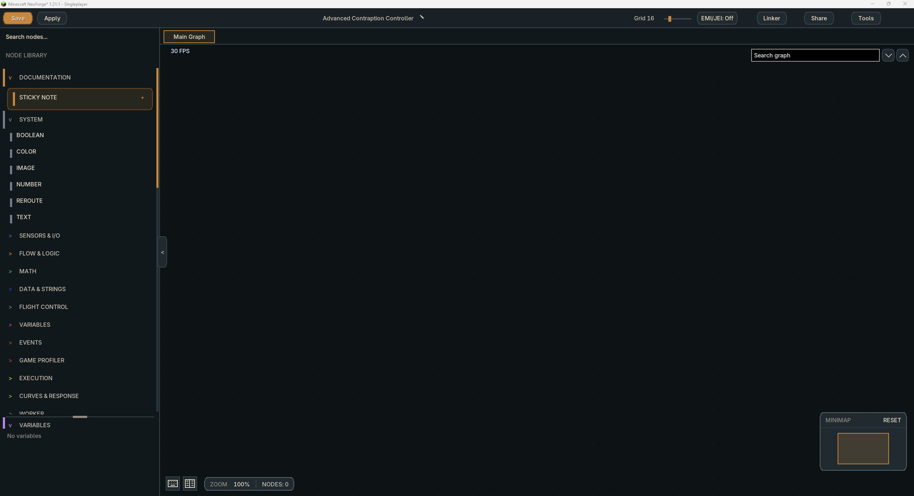

## Contents

- [Getting Started](#getting-started)
- [Hull Doors](#hull-doors)
- [Nodes](#nodes)
- [Port Types](#port-types)
- [Wiring](#wiring)
- [Best Practices](#best-practices)
- [Inputs and Outputs](#inputs-and-outputs)
- [Named Events](#named-events)
- [Functions](#functions)
- [Function Plotter](#function-plotter)
- [Graph sharing](#graph-sharing)
- [Shortcuts](#shortcuts)
- [Documentation](#documentation)
- [FAQ](#faq)

## In-game help

The keyboard icon at the bottom of the Node, SCM, Worker, and Schedule viewports opens a shortcuts grid for the current viewport. Each card shows an action and its key combination.

The book icon opens this documentation. Pages and images are bundled with the installed mod version and work offline. The Pages sidebar switches between the bundled wiki pages.

## Getting Started

Place down an `Advanced Control Computer` and use `Sneak + Use` to open the `Node Graph` GUI.

You can select one of the `Templates` or a `Blank` graph to get started.

Assuming you selected `Blank` the general layout of the GUI is:
- Left hand sidebar: Node browser.
- Center Graph: Graph workspace.

Holding `Shift` while hovering over a node in the `Node Browser` sidebar will show a summary explanation of what that node does.

Click the `.0` button before a node's name to `Show precise values`. This shows the full numeric value, including very small numbers, and is saved separately for each node. Calculations always use the full value.

Saving or applying a graph refreshes its live values in the open editor. The world continues ticking while the editor is open; the main world render pauses except when an SCM view or live 3D target picker needs it.

## Hull Doors

Open **SCM Graph**, choose the **Hull Doors** filter in the live craft view, select the ship's full-size doors and assign them to **Hull Doors**. Use **Save** to apply the group. Selecting either half of a door works; trapdoors are excluded. Door assignments do not require propulsion reinitialization.

The SCM's configured forward vector defines North. At each Ship Dock, enable door control and choose the local cardinal sides to open while docked. Only doors in the Hull Doors group are controlled; they close before the connector releases.

The Ship Dock shows **Disabled** while Open Doors is off; assigning Hull Doors alone does not enable the dock's request. Click the Open Doors checkbox or label to enable it. The SCM brain's **Dock doors** section shows selected and mapped doors, locked connections, the linked dock's enabled state and requested sides.

## Nodes

<strong>Event Nodes</strong>

| Node | Inputs | Outputs | Description |
| --- | --- | --- | --- |
| On Update | - | Execution | Pulses once every game tick. |
| Periodic Pulse | Interval | Execution | Pulses at a configurable interval. |
| On Value Changed | Value | Execution, Value | Pulses when the supplied value changes. |
| Pulse If | A, Operator, B | Execution | Pulses every game tick while A and B satisfy the selected comparison. B uses the same data type as A. |
| Delta Time | - | Value | Returns delta time. |
| On Channel Change | Key | Execution, Value | Pulses when the channel changes. |
| On Graph Ready | - | Execution | Pulses when the node graph has finished loading and is ready to run. |
| On Graph Event | - | Execution | Pulses when its configured graph event is triggered. |
| On Named Controller Event | Event | Execution, Data | Pulses when a `Send Named Controller Event` node with the same event name is pulsed. |
| Send Named Controller Event | Execution, Data, Distance | Execution | Pulses `On Named Controller Event` nodes with the same `Event` name and transmits data. |
| On Physical Interaction | - | Execution, (Event Data) | Pulses when a player interacts with the controller. |
| On Redstone Change | - | - | NYI. |
| On Variable Change | - | Execution, Value | Pulses when the supplied variable changes. |

<strong>Sensor and I/O Nodes</strong>

| Node | Inputs | Outputs | Description |
| --- | --- | --- | --- |
| Configured Key Input | Key | Execution, Active, Value | Pulses when the configured Key is pressed. |
| Configured Key Output | Execution, Value, Value Type | Execution | Sends a value to the configured controller output using the selected Redstone or Scalar value type. |
| Direct Target Output | Execution, Target, Value, Value Type | Execution | Controls the selected target using a Redstone strength or Scalar value. |
| Discovered Target Input | Target | Execution, Active, Value | Reads the selected loaded target's physical signal. Redstone sources return strengths from 0 to 15; dedicated analogue controls retain their scalar values. |
| Gamepad Input | Key | Execution, Active, Value | Pulses and returns an analogue value from a gamepad event. |
| Goggles Tracker | - | Multiple | Returns information about the wearer and location of the paired `Smart Glasses`. |
| Linker Face Input | Target, Face | Execution, Active, Value | Reads the selected loaded target face's physical signal in both previews and active graphs. |
| Linker Face Output | Execution, Target, Face, Value, Value Type | Execution | Outputs a redstone signal to the target face using the selected Redstone or Scalar value type. |
| Local Redstone Input | - | Execution, Active, Value | Reads a local controller redstone signal. |
| Local Redstone Output | Execution, Value, Face, Value Type | Execution | Outputs a redstone signal on the selected controller face using the selected Redstone or Scalar value type. |
| Mouse Input | MouseInput, Capture Input, Reset Axis, Timeout | Execution, Active, Value | Captures the selected mouse control while Capture Input is true. Wire a Boolean to release or reacquire it while interacting with the controller. |
| Play Sound | Execution, Stop, Loop, Pitch, Sound, Volume, World, XYZ | Execution | Plays or stops a sound. |
| Redstone Link Input | Frequency | Execution, Active, Value | Pulses when receiving a redstone signal strength on the set frequency. |
| Redstone Link Output | Execution, Frequency, Value, Value Type | Execution | Outputs a redstone signal on the selected frequency using the selected Redstone or Scalar value type. |
| Controller Tracker | - | Multiple | Returns the controller holder, position, and identity. |
| Reset Outputs | Execution | Execution | Clears the controller's active outputs. |

`Value Type` defaults to `Redstone`, which rounds and clamps strengths to whole numbers from `0` to `15`. `Scalar` accepts values from `0` to `1`; redstone outputs convert these to integer strengths, while supported analogue controls retain their precision. Zero, including `0.0`, turns off the node's redstone output.

Physical target inputs report a Redstone Link receiver's received power or a transmitter's transmitted power. Output nodes report their own written values.

<strong>Flow and Logic Nodes</strong>

| Node | Inputs | Outputs | Description |
| --- | --- | --- | --- |
| And | A, B | Boolean | Outputs `TRUE` if both inputs are `TRUE`. |
| Branch | Execution, Boolean | Execution (TRUE), Execution (FALSE) | Logical `IF`  statement, pulses `TRUE` or `FALSE` when pulsed based on `Boolean`. |
| Compare | A, B, Operator | Boolean | Compares both inputs using an operator and outputs `TRUE` or `FALSE`. |
| Edge Detector | Boolean | Falling (Boolean), Rising (Boolean) | NYI. |
| Flip-Flop | Execution, Flip On, Skip Pulses | Execution, Boolean | Alternates between `TRUE` and `FALSE` on Every Pulse, Every Second Pulse, or Every Nth Pulse. Skip Pulses appears in Nth mode; zero skips behaves like Every Pulse. Execution passes through every pulse. |
| Gate | Execution | Execution, Open (Boolean) | Allows `Execution` to flow through only when `Open` is `TRUE`. |
| Latch | - | - | NYI. |
| Not | Boolean | Boolean | Inverts a Boolean. |
| Or | A, B | Boolean | Outputs `TRUE` when either input is `TRUE`. |
| Pulse On Change | Value | Execution | Pulses when `Value` changes. |
| Select Data | Condition (Boolean), True (datatype any), False (datatype any) | Value | Outputs either `True` or `False` input value depending on the Boolean condition. |
| Switch | Type, Selector | Execution or Data | Selects the zero-based execution output in `Execution` mode, or returns the selected `Data` case in `Data` mode; falls back to `Default`. |

<strong>Math Nodes</strong>

| Node | Inputs | Outputs | Description |
| --- | --- | --- | --- |
| -x | Value | Value | Inverts a number between positive and negative. |
| ACos | Number, Angle Unit | Value | Outputs the arccosine of a number in the selected angle unit. |
| ASin | Number, Angle Unit | Value | Outputs the arcsine of a number in the selected angle unit. |
| Absolute | Number | Value | Returns the number without a negative sign. |
| Add | A, B | Value | Adds both numbers together. |
| Angle from Coords | Origin (map), Target (map) | Euler, Quaternion, Tait-Bryan, Axis, Angle, Degrees, Valid | Calculates a 3D rotation from Origin toward Target. Axis and Angle describe the full rotation; Degrees is a separate horizontal heading. |
| Atan | Number, Angle Unit | Value | Outputs the arctangent of a number in the selected angle unit. |
| Atan2 | Y, X, Angle Unit | Value | Outputs the angle of Y and X in the selected angle unit, using the correct quadrant. |
| Average | A, B | Value | Outputs the average of both numbers. |
| Ceil | Number | Value | Rounds a number up to the nearest whole number. |
| Clamp | Min, Max, Value | Value | Keeps a number between the chosen minimum and maximum. |
| Convert Angle | Input Angle Type, Output Angle Type, Angle, Axis, Angles or Rotation Map | Converted Angle or Rotation Map, Axis or Components, Cardinal, Valid | Converts angle units and 3D rotation formats, or returns a world compass direction as a string. The selected formats determine the ports. |
| Convert Unit | Unit Type, Input Unit, Output Unit, Value, Voltage (V), Duration (s) | Result, Valid | Converts compatible time, distance, speed, weight or fluid volume units. Power conversions are available when Create: Power Grid is installed. |
| Cos | Value, Angle Unit | Value | Returns the cosine of an angle in the selected unit. |
| Curve | Value, Min, Max, Speed | Value | Maps a clamped value through a drawn curve. |
| Divide | A, B | Value | Divides A by B. |
| Exp | Number | Value | Outputs e raised to the power of a number. |
| Floor | Value | Value | Rounds a number down to the nearest whole number. |
| LN | Number | Value | Returns the natural logarithm of a number. |
| Log | Base, In | Value | Returns the logarithm of a number using the selected base. |
| Lerp | Execution, A, B, Amount | Execution, Value | Blends between 2 numbers by the chosen amount. |
| Map Range | In Min, In Max, Out Min, Out Max, Value | Value | Converts a number from one range to another. |
| Max | A, B | Value | Outputs the larger of both numbers. |
| Min | A, B | Value | Outputs the smaller of both numbers. |
| Modulo | A, B | Value | Outputs the remainder after dividing A by B. |
| Moving Average | In, Samples | Average | Averages the most recent values to smooth a noisy number. |
| Multiply | A, B | Value | Multiplies both numbers together. |
| Peak | In | Max, Min | NYI. |
| Power | Base, Exp | Result | Raises the base number to an exponent. |
| Random Float | - | Value | Returns a random float value between 0.0 and 1.0. |
| Random Float In Range | Min, Max | Value | Returns a random float value within the min/max range. |
| Random Int | Max | Value | Returns a random whole number. |
| Random Int In Range | Min, Max | Value | Returns a random whole number within the min/max range. |
| Round | Value | Value | Rounds a number to the nearest whole number. |
| SQRT | In | Out | Returns the square root of a number. |
| Sin | Value, Angle Unit | Value | Returns the sine of an angle in the selected unit. |
| Subtract | A, B | Value | Subtract B from A. |
| Tan | In, Angle Unit | Out | Outputs the tangent of an angle in the selected unit. |
| Value Delta | In | Delta | Outputs the change in value since the previous graph tick. |
| Vector Add | A (map), B (map) | Value (map) | Adds both vectors together. |
| Vector Difference | A (map), B (map) | Value (map) | Returns the absolute difference between both vectors on every axis. |
| Vector Distance | A (map), B (map) | Value (number) | Returns the distance between both vectors. |
| Vector Magnitude | A (map) | Value (number) | Returns the length of the vector. |
| Vector Invert | A (map) | Value (map) | Negates every value in the vector. |
| Vector Multiply | A (map), B (map) | Value (map) | Multiplies the X,Y,Z values of both vectors together. |
| Vector Subtract | A (map), B (map) | Value (map) | Subtracts Vector B from Vector A. |

`Sin`, `Cos`, `Tan`, `ASin`, `ACos`, `Atan` and `Atan2` offer an `Angle Unit` selector: Radians, Degrees, Turns or Gradians. Forward functions interpret the input in that unit; inverse functions return an angle in that unit. New nodes and older graphs without a selection use Radians.

`Convert Angle` has independent `Input Angle Type` and `Output Angle Type` selectors for Radians, Degrees, Turns, Gradians, Axis-Angle, Euler, XYZ Tait-Bryan and XYZW Quaternion. Scalar formats use `Angle`, an XYZ `Axis` map defaulting to +X, and an optional `Angles` map. Axis-Angle uses an axis map and an angle in radians. Euler (ZYZ) uses Alpha (Z), Beta (Y), Gamma (Z), composed as Rz(alpha) * Ry(beta) * Rz(gamma). XYZ Tait-Bryan uses Roll (X), Pitch (Y), Yaw (Z), composed as Rz(yaw) * Ry(pitch) * Rx(roll). Both accept and return degrees, including their component outputs. Euler beta is in [0, 180]; at beta = 0 or 180, gamma is zero and alpha carries the remaining rotation. Their maps identify `representation` (`euler` or `tait_bryan`), `convention` (`zyz` or `xyz`) and `unit`. Tagged maps honor their convention and unit on input, including explicit legacy `zxz` Euler or `yxz` Tait-Bryan maps; untagged maps use the selected format and degrees. Older untagged yaw/pitch/roll maps saved under the Euler selection retain their YXZ interpretation on input; Euler outputs always use ZYZ. Euler component IDs remain `alpha`, `beta`, `gamma` for saved wires. Quaternion uses an XYZW map. Changing a format updates the ports and removes incompatible wires.

Select **Cardinal** as `Output Angle Type` for a `Cardinal` string: North, North East, East, South East, South, South West, West or North West. Scalar angles are world headings in the selected unit, matching `Angle from Coords`: 0° South (+Z), 90° East (+X), 180° North (-Z), 270° West (-X). The nearest direction is selected in 45° sectors, including signed angles and repeated turns. Rotation inputs project rotated +Z onto the world X/Z plane. A directly vertical rotation returns an empty string with `Valid` false. Cardinal is available only as an output format.

Angle-unit conversions preserve signs and multiple turns, including numeric fields inside `Angles` maps. Converting a full rotation to a scalar returns its shortest angle and axis. For a full 3D rotation from `Angle from Coords`, connect both `Axis` and `Angle`; its `Degrees` output is a separate horizontal heading. Older degree/radian, axis-angle/quaternion and Euler/Tait-Bryan/quaternion converter nodes continue working in saved graphs but are hidden from the node browser; use `Convert Angle` for new graphs.

`Convert Unit` starts with Ticks to Seconds. Changing `Unit Type` refreshes both unit menus and replaces incompatible selections. Signed and fractional values are preserved; invalid, incompatible or overflowing conversions return `Result = 0` and `Valid = FALSE`.

| Unit Type | Available Units |
| --- | --- |
| Time | Ticks, seconds, minutes, hours, milliseconds, days, weeks, microseconds and nanoseconds. |
| Distance | Meters, kilometers, miles, yards, blocks, feet, inches, centimeters, millimeters, micrometers and nautical miles. |
| Speed | Meters/second, kilometers/second, kilometers/hour, miles/hour, knots, blocks/second, blocks/tick, feet/second, yards/second, meters/minute and blocks/minute. |
| Weight | Grams, kilograms, tonnes, milligrams, micrograms, ounces, pounds, stone, US short tons and UK long tons. |
| Fluid Volume | Buckets, millibuckets, liters, milliliters, microliters, cubic meters, cubic centimeters, US and Imperial fluid ounces, gallons, quarts and pints, US and metric cups, US tablespoons and US teaspoons. |
| Power | Available with Create: Power Grid. Converts electrical energy, power, current and charge using the installed mod's FE ratio. |

Ticks use the nominal 20 ticks per second, one block equals one meter, and one bucket equals 1000 mB or one liter. Days are 24 hours; US and Imperial liquid units remain distinct. Power conversions expose `Voltage (V)` and `Duration (s)` when needed, both defaulting to `1`. The game and web editors use the same unit choices and conversion rules.

<strong>Core and Variable Nodes</strong>

| Node | Inputs | Outputs | Description |
| --- | --- | --- | --- |
| Number | - | Value | Outputs a configured number. |
| Boolean | - | Value | Outputs a configured TRUE or FALSE value. |
| Text | - | Value | Outputs configured text. |
| Reroute | Value | Value | Passes a value through to keep long or crossing wires readable. |
| Sticky Note | - | - | Adds a note to the graph. It has no runtime behaviour. |
| Image | - | Image | Use the node's Upload button to enter an image URL or embed a file from disk. The typed Image output retains embedded assets for other nodes and widget/HUD image elements. |
| Gradient | Value (0–100) | Color, Gradient | Edit the gradient on the node body. Color samples the selected percentage; Gradient returns an ordered map of 100 opaque colors, indexed 0–99, including both endpoints. Ctrl-click the preview to add a step, Shift-click an interior step to remove it, drag to move a step, or double-click to change its color. The same shortcuts work in the Thruster Dye Applicator. |
| Get Variable | - | Value | Returns the current value of the selected graph variable. |
| Set Variable | Execution, Type, Default, Value | Execution, Value | Writes a graph variable and returns the value that was written. |

<strong>Game Profiler Nodes</strong>

| Node | Inputs | Outputs | Description |
| --- | --- | --- | --- |
| FPS | - | Value | Returns the current frames per second. |
| MSPT | - | Value | Returns the current milliseconds per tick. |
| TPS | - | Value | Returns the current ticks per second. |
| Frametime | - | Value | Returns the current frame time. |

<strong>Execution Nodes</strong>

| Node | Inputs | Outputs | Description |
| --- | --- | --- | --- |
| Do Once | Execution, Reset | Execution | Lets the first pulse through, then waits for Reset. |
| Do N | Execution, Count, Reset | Execution, Index | Lets a configured number of pulses through and returns the zero-based pulse index. |
| Bounded Loop | Execution, Iterations | Execution, Iteration, Complete, Index | Passes an accepted pulse through Execution, then pulses Iteration once per tick with a zero-based Index. Pulses Complete after the last iteration. |
| Delay | Execution, Ticks | Execution | Delays a pulse by the selected number of game ticks. |
| Debounce | Execution, Ticks | Execution | Ignores further pulses until the selected number of game ticks has passed. |
| Timer | Start, Stop, Duration | Complete, Elapsed | Starts or stops a timer and pulses Complete when it reaches Duration. |
| Parallel Execution | Execution | Multiple Execution | Sends one pulse to every added execution output. |
| Sequenced Execution | Execution | Multiple Execution | Sends a pulse through its added execution outputs in order. |
| Exec Combine | Multiple Execution | Execution | Combines added execution inputs into one execution output. |

`Bounded Loop` captures `Iterations` when it starts, from `0` to `256`, and defaults to `1`. Pulses received while it is running are ignored. Zero iterations pulses `Complete` without an iteration.

<strong>Curves and Response Nodes</strong>

| Node | Inputs | Outputs | Description |
| --- | --- | --- | --- |
| Ramp | Execution, Value, Rise, Fall, Reset Delay | Execution, Value | Moves the output toward Value using separate rise and fall rates. |
| Step Response | Value, Step | Value | Changes the output in fixed steps toward Value. |
| Deadzone | Value, Start, Resist | Value | Removes small input movement around the chosen start point. |
| Smoothing | Execution, Value, Amount | Execution, Value | Smooths a changing value by the configured amount. |
| PID | Target, Actual, P, I, D, Reset | Value | Produces a proportional, integral, and derivative controller output. |
| LQR Controller | Target, Actual, Gain, Feed Forward, Min, Max | Value | Produces a bounded linear-quadratic control output. |
| ADRC | Target, Actual, Reset, Delta Time, Controller Bandwidth, Observer Bandwidth, Plant Gain, Output Limit | Value, Disturbance | Produces an active disturbance rejection control output and reports its estimated disturbance. |
| ADRC Nth Order | Target, Actual, Reset, Order, Delta Time, Controller Bandwidth, Observer Bandwidth, Plant Gain, Output Limit | Value, Disturbance | Produces an Nth-order active disturbance rejection control output. |

<strong>Data Nodes</strong>

| Node | Inputs | Outputs | Description |
| --- | --- | --- | --- |
| Join Text | A, B, Added Text Inputs | Value | Joins the configured text inputs in order. Use Add Input to append more text values. |
| Split String | String, Split By, Delimiter / Pattern | List | Delimiter splits text at literal separators. Regex returns every complete matching entry as a list. Existing nodes default to Delimiter. |
| Substring | String, Start Index, End Index | Value | Returns the selected range of text. |
| Find in String | String, Search | Index | Returns the position of text inside another text value. |
| Convert Type | Value, Output Type | Value | Converts a value to the selected output data type. |
| Make List | Value | List | Creates a list from its configured and connected values. |
| Get List Value | List, Index | Value | Returns the value at a zero-based list index. |
| Create Structure | Key, Value | Map | Creates a map entry from a key and value. |
| Get Structure Value | Map, Key | Value | Returns the value stored at a map key. |
| Split List | Value | Multiple Values | Breaks a list or map into separate ordered output ports. |
| Break Out | Value | Multiple Values | Breaks a map or structured value into ordered dynamic output ports. |
| Display Link Input | - | Data, Per-Link Updates and Values | Receives Create Display Link data sent to this ACC. Each sender has its own collapsible section with an Updated pulse, Text, Lines, parsed Value, Line Count, Target Line, Source Name/Type, Updated Tick and Sequence. |
| Get Data | Targets, Merge Like Ports | Data, Dynamic Data | Reads the selected blocks or faces and adds their exposed data ports. Physical redstone readings use strengths from 0 to 15. |
| Set Data | Execution, Targets, Merge Like Ports, Value Type, Redstone Signal Strength, Dynamic Data | Execution, Success | Writes the selected blocks or faces when pulsed. Each target retains an independent redstone signal strength. |
| Validate Number | Value | Value, Valid | Passes finite numbers through and reports whether the value is valid. |

`Get Data` and `Set Data` can select multiple blocks or separate faces of the same block. Each selected face retains its own target and ports; aliases label target sections without changing their wires. `Merge Like Ports` combines matching data fields, while Set Data's redstone controls remain independent for each target. Set Data uses the same `Redstone` and `Scalar` value types as output nodes; a zero strength, including `0.0`, clears its redstone output.

Container `Get Data` exposes `Items` as a map from item display name to numeric count, combining matching names, including component variants. `Item Count`, `Item Capacity` and `Item Fill` describe the represented storage; fill values range from `0` to `1`, and fluid level maps use fluid registry IDs. Smart Vault, Smart Tank and Smart Battery targets report their complete connected loaded storage network, including other resource types. Use map keys or `Break Out` for item entries rather than the older list of text entries.

A Shipping Manifest target reads its attached storage. Its generated `Display Text` separates entries with `, `, which can be used as a literal delimiter in `Split String`. Manually supplied display text remains literal.

<strong>String Nodes</strong>

| Node | Inputs | Outputs | Description |
| --- | --- | --- | --- |
| Split | In, Split On | Out | Splits text into a list. |
| Reverse | In | Out | Reverses text. |
| Append | Source, Text, Separator | Result | Adds text after the source text. |
| Prepend | Source, Text, Separator | Result | Adds text before the source text. |
| Trim | In | Out | Removes leading and trailing whitespace. |
| Replace | In, Find, Replace | Out | Replaces matching text. |
| Length | In | Length | Returns the number of characters in text. |
| Contains | In, Search | Result | Returns TRUE when text contains the search text. |
| Starts With | In, Prefix | Result | Returns TRUE when text starts with the prefix. |
| Ends With | In, Suffix | Result | Returns TRUE when text ends with the suffix. |
| To Upper | In | Out | Converts text to uppercase. |
| To Lower | In | Out | Converts text to lowercase. |
| Parse Into List | In, Delimiter | Array | Splits text into a list using the delimiter. |
| Join From List | Array, Separator | String | Joins list entries into text. |
| Regex | In, Pattern | Matches, Found | Returns every regex match, each followed by its capture groups in order. Found reports whether any match was found. |

`Regex` supports Java regular expressions, including lookahead and lookbehind, and searches the entire input. An invalid pattern returns an empty `Matches` list and `Found = FALSE`. `Split String` in `Regex` mode returns complete matches without adding capture groups as separate entries.

For example, `X\d+ .+?(?=X\d+ |$)` extracts `X12 Cobblestone`, `X32 Iron Ore`, `X1 Diamond Block` and `X19 Raw Copper` from their joined text. Connect the resulting list to `Split List` to expose all four entries.

<strong>List and Map Nodes</strong>

| Node | Inputs | Outputs | Description |
| --- | --- | --- | --- |
| Get Index | Array, Index | Item | Returns the item at a zero-based index. |
| Shuffle | Execution, Array | Execution, Out Array | Shuffles a list. |
| Sort | Execution, Array | Execution, Out Array | Sorts a list. |
| Slice | Array, Start, End | Out Array | Returns part of a list. |
| Append | Execution, Source, Append | Execution, Out Array | Appends one list to another. |
| Merge | A, B | Result | Merges two collections. |
| Add | Execution, Array, Item | Execution, Out Array | Adds an item to a list. |
| Add Unique | Execution, Array, Item | Execution, Out Array | Adds an item only when it is not already in the list. |
| Insert | Execution, Array, Item, Index | Execution, Out Array | Inserts an item at a zero-based index. |
| Remove Index | Execution, Array, Index | Execution, Out Array | Removes the item at a zero-based index. |
| Clear | Execution, Array | Execution, Out Array | Clears a list. |
| Find | Array, Item | Index | Returns the zero-based index of an item. |
| Contains | Array, Item | Result | Returns TRUE when a list contains an item. |
| Length | Array | Length | Returns the number of items in a list. |
| Last Index | Array | Index | Returns the last valid zero-based index in a list. |
| Sort Descending | Execution, Array | Execution, Out Array | Sorts a list in descending order. |
| Filter | Array, Key, Value, Operation | Result | Returns list entries that match the configured filter. |
| Push (Map/List) | Collection, Value, Key | Result | Appends a value to a list, or adds or replaces a map entry using Key. |
| Pop (Map/List) | Collection, Index | Result, Value, Removed | Removes the entry at a zero-based position and returns the remaining collection, removed value, and whether an entry was removed. |
| Contains (Map/List) | Collection, Value | Result | Returns TRUE when a list or map contains the value. |
| Index Of (Map/List) | Collection, Value | Index | Returns the zero-based position of a value in a list or map, or -1 when it is missing. |

Map/List operations preserve the collection type and entry order. A map index is the entry's zero-based position, rather than its key.

<strong>HUD and Display Nodes</strong>

In the designer's **Data** tab, each row represents an element parameter. Choose its input port from the dropdown, or choose **Default** to restore that parameter's static value. Multiple parameters can share the same port. For an image element, bind **Texture** to an image input connected to the **Image** node; uploaded images stay embedded in the saved graph.

Add **Dropdown** from the designer's **Interactive** tab. Under **Data**, bind **Options (List / Map)** to a List or Map input. New dropdowns reuse a collection input or create an `options` List field; change that field to Map or choose another collection field when needed. Map keys become option labels, while the Value output returns the original selected value, including nested lists and coordinate maps. Scalar list entries show their values; nested list entries use zero-based indices as labels. Exec pulses only when the selected item changes. The selected value refreshes with its bound data, and selections survive graph saves and restarts. Neumorphic, Glassmorphic, Material and Flat presets use the normal font, color, opacity, border, size, rotation, scale and parameter bindings. Popups support scrolling, keyboard navigation and mouse selection.

Basic **HUD Element** text now wraps within the panel width; text beyond the panel height is clipped.

**Advanced HUD Element** and **ACC Display Widget** expose a **Widget** output with the `widget` data type. It carries the generated canvas, resolved live bindings, and image assets. Hold Shift over this port for a scaled preview, or pin its inspector to keep a preview on the graph. When zoom hides the node controls, Shift-hovering the node also previews Widget. Design edits and live bindings refresh while the controller remains open, preserving submitted control values. Advanced mode shows the canvas; Simple mode shows its dimensions and element count. Widget values retain their type through generic ports, collections, variables, and saved port values.

| Node | Inputs | Outputs | Description |
| --- | --- | --- | --- |
| HUD Element | Label, Visible | - | Creates a basic HUD element for the paired goggles display. |
| Advanced HUD Element | Label, Visible | Widget | Creates a configurable advanced HUD element. Add a resizable `Camera Source` from the designer's `Interactive` tab and select its input under `Data` > `Camera Source`. Target values and camera names are supported. Its overlay provides stick, zoom, mode, flashlight, tracking, target lock, viewfinder, hit interaction and takeover controls. Use the interactive HUD to operate them. |
| ACC Display Widget | Label, Value, Visible, Layout and Style | Widget | Draws an interactive widget on an ACC Display. The designer's `Interactive` tab includes a resizable `Camera Source`; bind any input under `Data` > `Camera Source` to a camera Target or name. The feed has the same camera controls overlay, including a separate takeover button. Controls follow the element's size, rotation and scale. |
| ACC Hologram Widget | Label, Value, Visible, Layout and Style | - | Draws a widget beyond the ACC Display surface. |
| ACC Display Node Graph | Visible, Layout | - | Displays the live ACC graph and its normal interaction on an ACC Display. |
| ACC Display Function Plotter | Value, Visible, Layout | - | Plots a live number on an ACC Display. |
| ACC Display External Source | Visible, Layout | - | Adds a linked computer, monitor, or Display Link as an ACC Display source. |
| ACC Display Ship Information | Visible, Text, Layout | - | Displays ship and navigation information using the configured Ship Information display layout. |

<strong>Function Nodes</strong>

| Node | Inputs | Outputs | Description |
| --- | --- | --- | --- |
| Function | Dynamic Execution and Data | Dynamic Execution and Data | Calls a graph function. Its ports match the selected function's inputs and outputs. |
| Function Inputs | Dynamic Data | Dynamic Data | Defines the data and execution inputs available inside a graph function. |
| Function Outputs | Dynamic Data | Dynamic Data | Defines the data and execution outputs returned by a graph function. |

<strong>Ship Control Nodes</strong>

| Node | Inputs | Outputs | Description |
| --- | --- | --- | --- |
| Initialize Control Module | Execution, Ship Name, Control Mode, Scan Options | Execution, Success, Complete, Progress | Initializes the mounted Ship Control Module's ship and creates its control map. |
| Stop Initialization | Execution | Execution, Success | Stops an active Ship Control Module initialization. |
| Control Module Status | - | Status and Ship Data | Reports attachment, initialization, mapped unit and bearing counts, inertia, map ID, and status. |
| Ship Coupler Status | - | Coupler Data | Reports mapped Ship Couplers and their carriage state. |
| Set Flight Behavior | Execution, Behavior | Execution, Success | Selects how the Ship Control Module turns and moves during scheduled flight. |
| Yaw | Execution, Mode, Amount or Reference and Angle | Execution, Success, Complete | Turns the ship around its yaw axis in Free mode or holds the selected angle in Angle mode. |
| Pitch | Execution, Mode, Amount or Reference and Angle | Execution, Success, Complete | Turns the ship around its pitch axis in Free mode or holds the selected angle in Angle mode. |
| Pan, Tilt | Execution, Amount | Execution, Success, Complete | Applies the matching bearing movement. |
| Roll | Execution, Mode, Amount or Reference and Angle | Execution, Success, Complete | Turns the ship around its roll axis in Free mode or holds the selected angle in Angle mode. |
| Accelerate, Forward, Reverse | Execution, Amount | Execution, Success | Moves the ship along its forward axis. |
| Strafe | Execution, Amount | Execution, Success, Complete | Moves the ship sideways. |
| Ascend, Descend | Execution, Amount | Execution, Success | Moves the ship vertically. |
| Stabilize, Decelerate, Hover | Execution, Strength | Execution, Success | Applies the selected stabilization or stopping behaviour. |
| Climb to Y Level | Execution, Y, Speed | Execution, Success, Complete | Moves the ship to a world Y level. |
| Face Coordinates | Execution, X, Y, Z, Speed | Execution, Success, Complete | Turns the ship to face world coordinates. |
| Dock at Coordinates | Execution, Target, Speed, Tolerance, Rotation Options | Execution, Success, Complete | Navigates the ship to a docking position and orientation. |
| Navigate | Execution, X, Y, Z, Speed, Tolerance | Execution, Success, Complete | Navigates the ship to world coordinates. |
| Follow | Execution, Target, Speed, Distance | Execution, Success, Complete | Follows the selected target. |
| Stop Ship Control | Execution | Execution, Success | Stops active Ship Control Module movement. |
| Couple Carriage | Execution, Endpoint | Execution, Success, Complete | Tells one Ship Coupler, or all couplers, to attach a carriage. |
| Decouple Carriage | Execution, Endpoint | Execution, Success, Complete | Tells one Ship Coupler, or all couplers, to release a carriage. |
| Ship Telemetry | - | Motion, Orientation, Navigation and Collision Data, Air Pressure | Reports the mapped ship's live telemetry. Air Pressure is Sable's pressure at the ship's world centre of mass, as a percentage. |
| Dimension Pressure | Dimension | Air Pressure | Lists the dimensions advertised to the player. Outputs the selected dimension's Sable base pressure as a percentage, before altitude scaling. Current Dimension follows the controller. Missing dimensions return 0%. |
| Shipping Travel Metrics | - | Route, Fuel and Travel Data | Reports the active Shipping Schedule's travel metrics. |
| Shipping Manifest | - | Route and Stop Data | Reports the active Shipping Schedule's current and upcoming Ship Dock stops. |

`Yaw`, `Pitch` and `Roll` default to `Free`, retaining their `Amount` input. `Angle` mode replaces Amount with an angle in degrees and a `Reference` selector: `North Relative` or `Current Vector`.

<strong>Shipping Schedule Nodes</strong>

| Node | Inputs | Outputs | Description |
| --- | --- | --- | --- |
| Pause | Execution | Execution, Success | Pauses the active Shipping Schedule. |
| Resume | Execution | Execution, Success | Resumes the paused Shipping Schedule. |
| Restart | Execution | Execution, Success | Restarts the assigned Shipping Schedule from its first entry. |
| Skip | Execution | Execution, Success | Skips the current Shipping Schedule entry. |

## Port Types

Port types refer to the ports `Data Type` and are:
- String: A string.
- Number: A number, can be a float, double, or integer value.
- Map: A collection of named key,value pairs, parsed as a JSON object.
- List: A collection of values, parsed as a table or array.
- Boolean: A Boolean value.
- Widget: A generated canvas with resolved elements and media, previewed through Shift Inspector.
- Target: Always unwired, used in some nodes to specify a target block to read from or write to, like the `Get Data` and `Set Data` nodes.
- Any: Type agnostic, accepts any data type.

Ports keep their declared order. Expanded maps keep their field order and lists keep their numeric index order when copied, saved, or loaded.

Ports are color coded and type checked, non-matching types are rejected making it impossible to accidentally incorrectly wire them up.
If you need to convert a string to a number or any other type conversion use the `Convert Type` node and specify the output data type.

## Wiring

Wiring up nodes is simple, drag a wire from one of the ports and release it on top of the port you want to wire it into, you can release it into empty space on the node graph to open the wiring node browser context menu.

Wires are type checked and color coded, so only matching ports can be wired together.

Hovering a wire highlights its complete path above nodes and other wires. All other wires fade to 40% of their normal opacity until the pointer leaves the wire.

Some nodes have a `White Diamond` in their title bar, this is the `Execution Port`, those ports need to be `Pulsed` in order for that node to work, nodes without the `Execution` port are called `Passive` nodes and function on their own.

Examples of `Execution` nodes are:
- Set Variable: When pulsed updates the variable with the new value.
- Set Data: When pulsed updates the target block with the new properties.

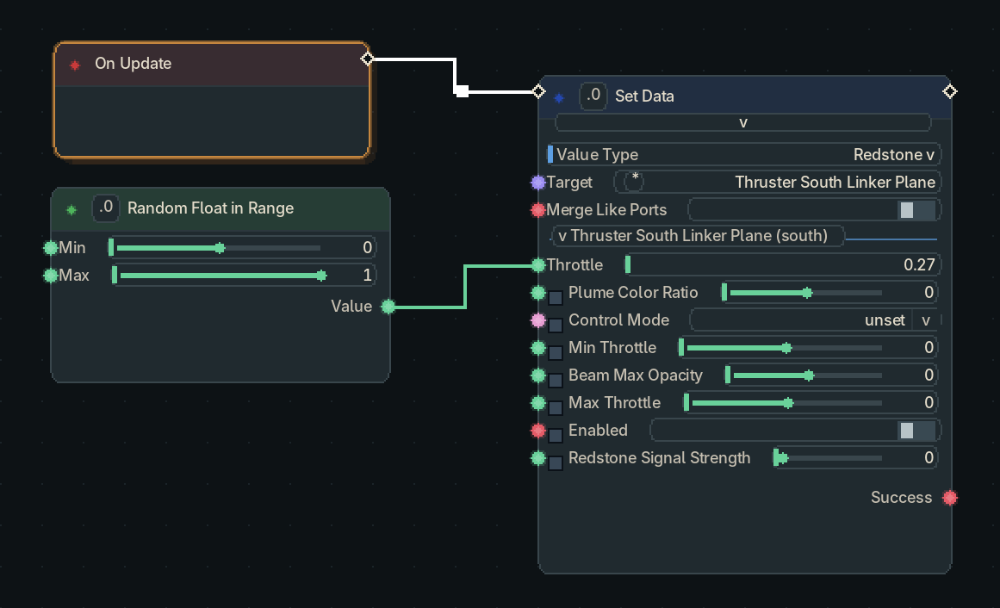

## Best Practices

The `On Update` node should be used sparingly, ideally not at all, instead if possible opt for using one of the other pulsing nodes like:
- Periodic Pulse
- On Value Changed
- Input Nodes
- Event Nodes

`On Update` runs every tick which can be very expensive on large `Node Graphs`.

When using inputs, you primarily want to use the `Configured [type] Input` nodes or `Linker Face Input`. The `Advanced Control Computer` is also able to read and send redstone signal from its sides.

For the best control experience use the `Contraption Network Linker` to wirelessly bind blocks and block faces to the `Advanced Control Computer` eliminating the need for `Redstone Links`.

`Direct Target Output`, and `Linker Face Output` are functionally similar nodes, where `Linker Face Output` outputs a redstone signal strength (0-15), and `Direct Target Output` outputs a quantized redstone signal strength (0.0 - 1.0). For complete control of the target block use the `Set Data` node to directly set values and properties of the block.

`Get Data` and `Set Data` are powerful nodes and can be used in any graph instead of any other block input/output nodes.
`Get Data` and `Set Data` support multiple targets on a single node.

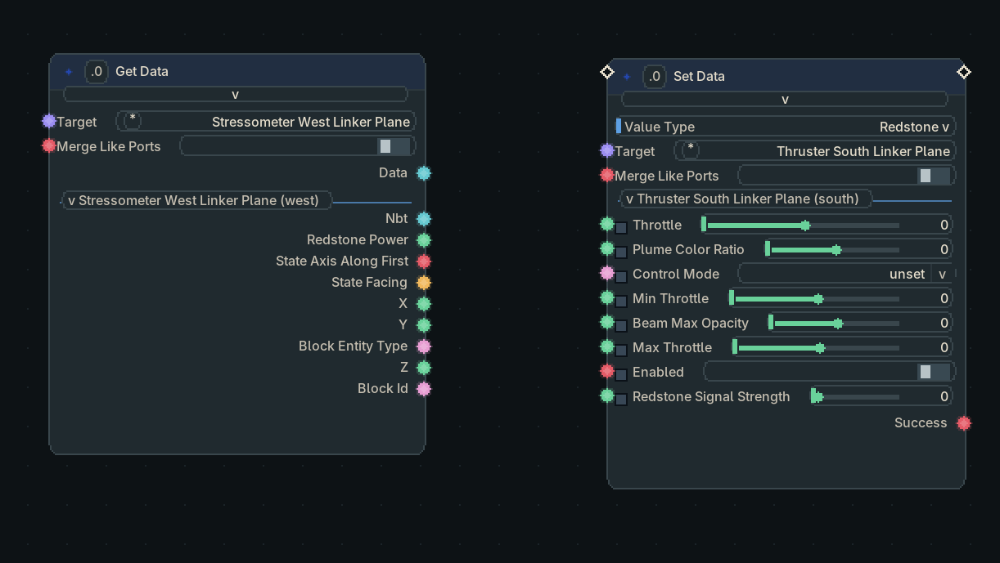

Double clicking on a wire will add in a `Re-Route` node for better wire aesthetics.

`Tools > Wires` switches between `Straight` and `Bezier`. Straight wires use horizontal, vertical and 45-degree diagonal segments. Bezier wires use full cubic curves, including complete curve spans through backward turns. `Tools > Avoid nodes` enables automatic detours around unrelated node bodies and is **off by default**. With avoidance off, wires follow the connected ports and can pass underneath other nodes. Both settings retain the port-side turns needed for backward connections. Re-route nodes rotate automatically with the connected flow. Both settings are saved as client preferences and apply when opening other controller graphs.

Using CTRL + Left Click on a wired port circle will disconnect the wire.

The `Named Event` nodes can be used in the same graph to transmit execution pulses and data cleanly across large graphs without long messy wires.

Sticky notes should be used to annotate what node clusters do and comment groups should be used for visual clarity and readability of the graph.

The `Contraption Network Linker` does not need to remain installed in the `Advanced Control Computer`, it can be re-used by inserting it, and clicking `PULL`. This does NOT clear the targets in the `Contraption Network Linker` but duplicates them into the `Advanced Control Computer`.
To clear the `Contraption Network Linker` target list, remove it from the controller, and open its dedicated GUI (Sneak + Right Click) then click `Clear` on the bottom left.

To copy targets from an `Advanced Control Computer` to a new `Contraption Network Linker`, insert the `Linker` into the `Linker Slot` and click `PUSH`.

To manipulate the stored targets inside the `Advanced Control Computer` click the `Stored` button, this will open a familliar `Linker GUI` as a modal for you to use.

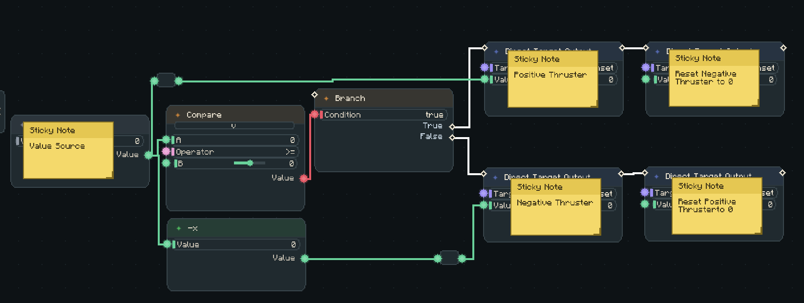
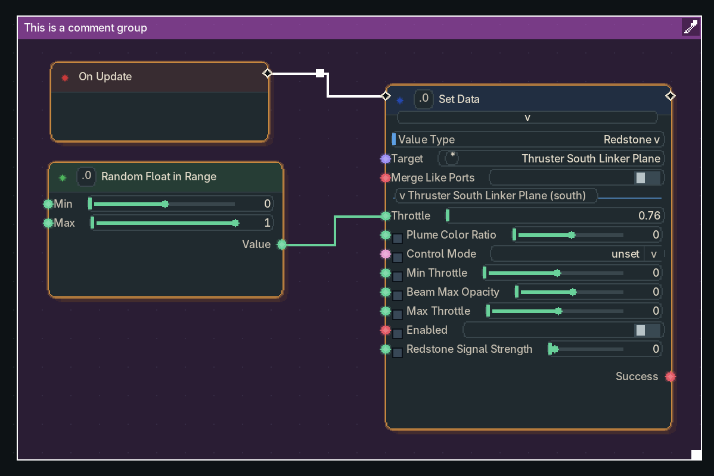
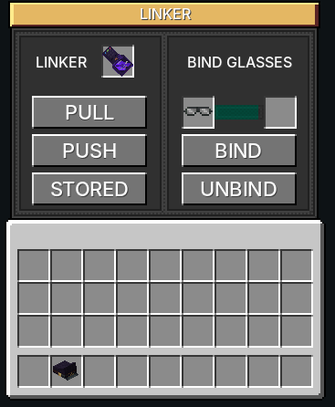
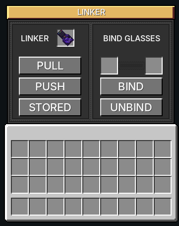

## Inputs and Outputs

Input nodes bring a player action, controller value, redstone signal, wireless signal, or tracked data into the graph. Output nodes send a value or action back out. A node does not automatically know which block it should use: select the node, then set its target, face, key, or frequency in the right-hand `Bindings & Targets` panel.

For direct wired targets, hold a `Contraption Network Linker` and use it on a block to add it as an `Input` or `Output`. Select the matching `Linker Face Input` or `Linker Face Output` node in the editor, then choose that binding and the face it should read or power.

<strong>Input Nodes</strong>

| Node | What it reads | How to use it |
| --- | --- | --- |
| Configured Key Input | A key configured on the ACC. | Configure a controller input and select it on the node. It pulses when that input changes. |
| Gamepad Input | A configured gamepad or controller input. | Configure the input on the ACC, then select it on the node. |
| Mouse Input | Mouse movement or buttons from a paired control source. | Use `Capture Input` to capture the selected control or release it for normal mouse look while retaining the last values. It defaults to true and accepts a Boolean wire. Use `Reset Axis` and `Timeout` when the control needs to return to centre. |
| Redstone Link Input | A Redstone Link frequency. | Set the frequency pair on the node. It returns `Value` and `Active` when the wireless signal changes. |
| Discovered Target Input | A discovered target block. | Select a target from the node's bindings. It returns that target's signal. |
| Linker Face Input | A face on a Contraption Network Linker input target. | Bind the block with a linker, then select the target and face on the node. |
| Local Redstone Input | A local controller redstone signal. | Select the face to read in the node configuration. |
| Controller Tracker | The controller's holder, position, and identity. | Use its outputs directly where player or controller data is needed. |
| Goggles Tracker | The paired Smart Glasses wearer, position, facing, and look target. | Pair Smart Glasses, then use its outputs directly. |
| Get Data | Dynamic data exposed by a selected target block. | Select the target. The node adds ports for the target's available data. |

<strong>Output Nodes</strong>

| Node | What it controls | How to use it |
| --- | --- | --- |
| Configured Key Output | An ACC controller output channel. | Select the configured output and pulse the node with the value to send. |
| Redstone Link Output | A Redstone Link frequency. | Set the frequency pair and wire a value from `0` to `15`. |
| Direct Target Output | A discovered output target. | Select a target binding and wire a quantized value from `0.0` to `1.0`. |
| Linker Face Output | A face on a Contraption Network Linker output target. | Bind the block as an output with a linker, then select the target and face. |
| Local Redstone Output | A local ACC face. | Select the face and wire a value from `0` to `15`. |
| Set Data | Dynamic data exposed by a selected target block. | Select the target, wire the data ports to change, and pulse `Execution`. |
| Play Sound | A sound at the controller or a world position. | Set the sound and optional world position, then pulse `Execution`. |
| Reset Outputs | Every active controller output. | Pulse it to clear the ACC's configured outputs. |

A direct target is selected from the controller's discovered bindings. A linker face target is selected from bindings created by the `Contraption Network Linker`. Use a Redstone Link node when a normal Create frequency is the better fit, and use local redstone nodes when the signal belongs on the controller itself.

`Discovered Target Input`, `Linker Face Input`, and `Get Data` read the selected loaded block's physical signal in both graph previews and active graphs. Ordinary redstone sources return `0` to `15`; dedicated analogue controls keep their scalar values. Redstone Link receivers report received power and transmitters report transmitted power. Output nodes report their own written values.

`Get Data` and `Set Data` can select separate faces of the same block. Each face keeps its own target and ports. Set an alias to label a target section without changing its wires.

Contraption Diagram targets expose **Air Pressure**, sampled through Sable at the target ship's world centre of mass. Pressure outputs use percentages (`100` means 100%) and may exceed 100; unavailable ships return `0`.

When using `Set Data` with a `Smart Gearbox`, Servo and Servo Locked modes show each face's angle, maximum angle, and Clockwise or Counter Clockwise direction. Passthrough modes show inversion, RPM caps, and independent `N/S Output Speed %` and `E/W Output Speed %` controls from `0` to `100`. Auto shows both sets. Face angles are limited in both directions by their maximum angle, and older gearboxes start both lane percentages at `100`.

## Named Events

Named events are a pair of nodes that allow wireless communication across `Advanced Control Computers` and `CC:Tweaked`.

To use them simply set up a `Send Named Event` node with a name and the data, then in any other `Advanced Control Computer` set up the `On Named Event` node with the same name, it will pulse its `Execution` wire when it receives an event.

Named events can also be used with the [CC:Tweaked Bridge](https://github.com/Riieno/Gadgets-And-Gizmos/wiki/CC:Tweaked-Bridge) over `Rednet` using `Wireless Modems` by setting the `Named Event Name` as the Rednet Channel to send and receive between the `Advanced Control Computer` and the `CC:Tweaked Computer`.

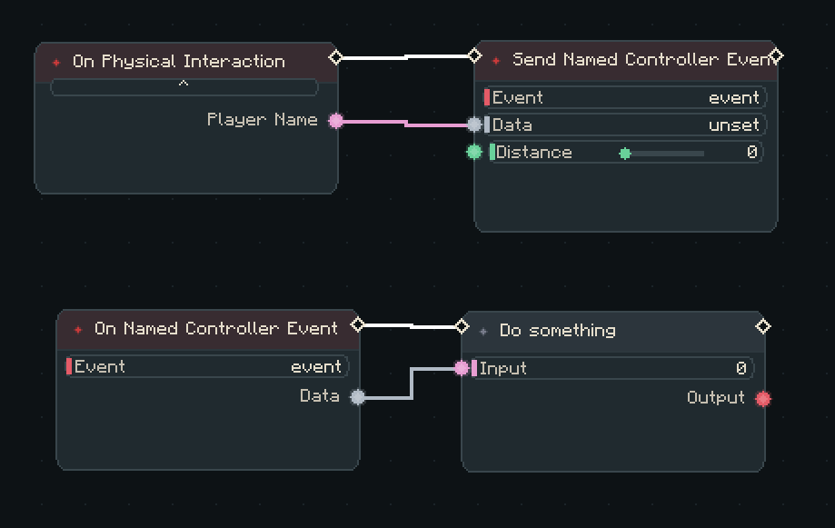(named-events)

## Functions

Functions are a term used for node groups, to create a function, select multiple nodes on a graph and right click on one then select `Convert to function`. This will move those nodes into a `Sub-Graph`.
You can also do this by right clicking on a `Comment Group` and selecting `Convert to function`.

Function node browsers include registered categories and dynamic execution nodes such as `Exec Combine`, `Parallel Execution`, and `Sequenced Execution`. Dropping an execution wire into empty space offers matching flow nodes.
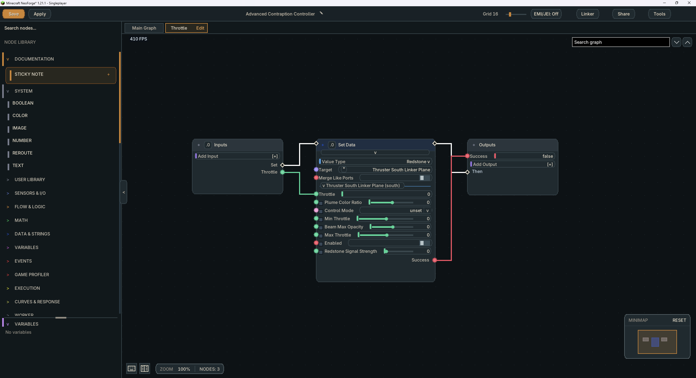
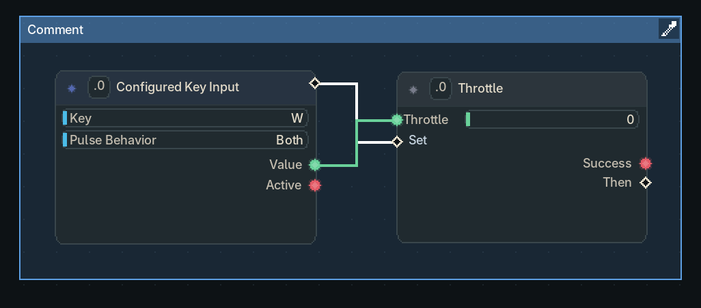

## Function Plotter

The Function plotter is a 2D Math notation function plotter, allowing you to plan out complex math formulas and convert them into `Graph Functions` to be used inside the node graph.

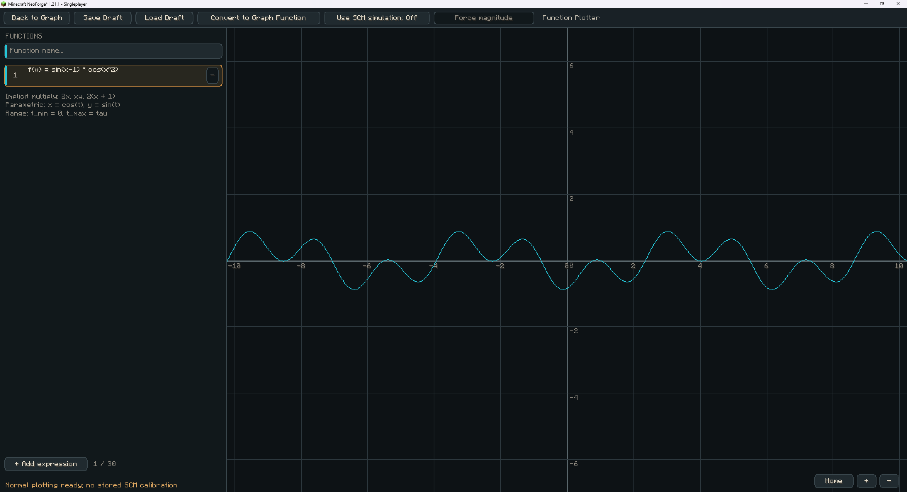

## Graph Sharing

To share a graph, click on the `Share` button in the tool bar and give it a name. You have 2 options for sharing.
- Local: saves the graph locally to the /shared_graphs directory as a JSON file to be sent to friends.
- Share Link: Saves the graph on the https://gg-mc.com server to be shared over the internet via share link.

The name entered in the Share modal becomes the graph's display name; its JSON filename remains an independent file identity. Shared manifests include the author name and UUID, sharing time, creation/import dates, addon and game versions, and graph statistics. Downloading and importing a shared graph preserves the original attribution.

The local browser bridge starts with the client, including when connected to a dedicated server. The website's download-into-game flow adds the graph to that client's `shared_graphs` folder. The Share list refreshes while open, so downloaded client graphs appear alongside server graphs.

The graph list refreshes client files and server files together. `[C]` marks a client graph and `[S]` marks a server graph, even when their names match. Saving locally keeps the server entries visible. Loading a client graph imports it into the controller; loading a server graph reads it from server storage.

The graph editor is available on the public website. The mod retains the local import bridge and its confirmation page; it no longer bundles a browser editor or exposes an Open Editor button in the Share modal.

<strong>Website Deployment</strong>

Run `generateGraphWebCatalog` to export the experimental node catalogue and reusable library browser API into `build/generated/graph-web-catalog`. Copy the resulting `nodes.json` and `graph-nodes.js` into the separately hosted website when updating it. Use `-Pweb_catalog_output=<directory>` for another output location. These generated files are not packaged with the addon.

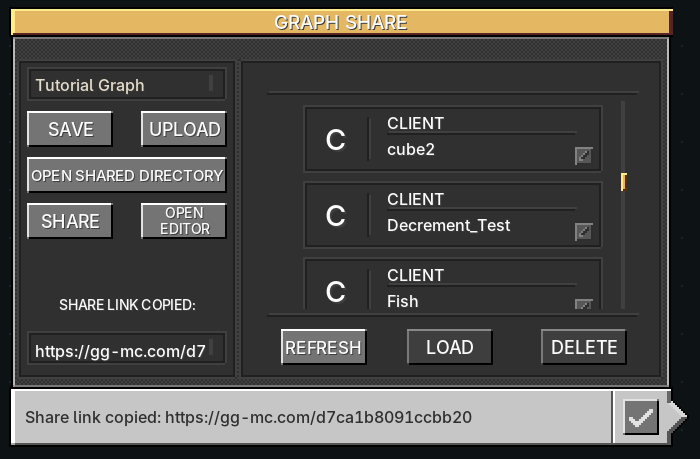

## Shortcuts

You can view the shortcuts at any time inside the `Advanced Control Computer` by clicking the `Shortcuts` icon at the bottom left of the viewport.

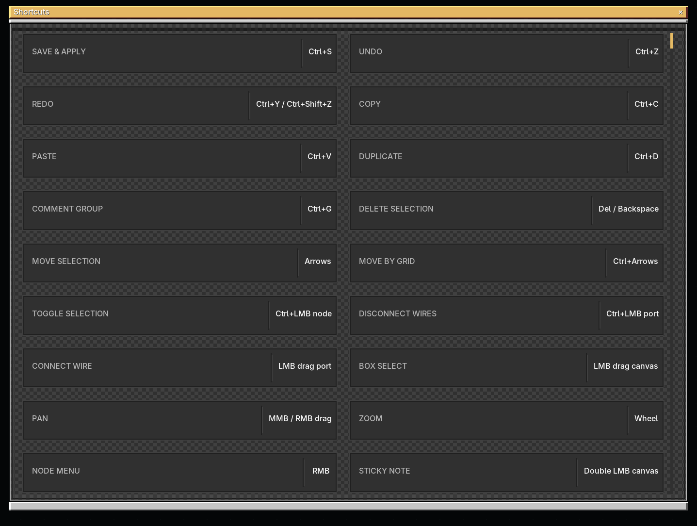

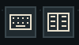
## Documentation

You can view the current bundled documentation for your build in game by clicking the `Documentation` icon on the bottom left of the `Advanced Control Computer` viewport.

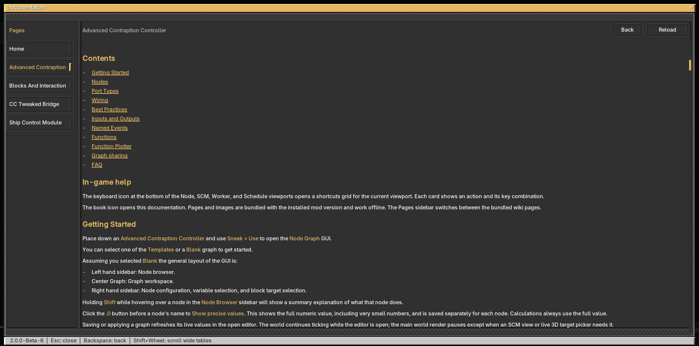

## FAQ

Where are shared graphs saved?
- In the minecraft /shared_graphs directory on the server or client, you can choose when saving a graph

When I create a share link what happens?
- When you create a share link, your current saved graph is parsed into a JSON format, serialized and sanitized then uploaded to https://gg-mc.com with a UUID for it, you can then copy and paste that link to send it to a friend. Opening the link will load a web based node graph that doesn't function but will show the layout and wiring of the saved graph and allow downloading the graph or installing it directly into the Minecraft instance

How do I use the `HUD` nodes?
- Open the `Linker` GUI, place Smart Glasses or a Pilot Hat in the binding input slot, and click `Bind`. Wait for the progress bar to complete, then take the item from the output slot and equip it to use the `Goggles Tracker` and `HUD` nodes. Inserting an item alone never changes its binding. To remove a binding, including one belonging to another ACC, insert the bound item and click `Unbind`.

### Create Display Link input

Set a Create Display Link target to the Advanced Contraption Controller and configure its normal source. Add a Display Link Input node to read its incoming streams. Each sender has a separate collapsible output section; Updated pulses after each received transfer. Text joins all lines, Lines is a list, and Value parses a wholly numeric first line or returns that line as text. Sender sections and their port identities persist across reloads. Removing or retargeting a loaded sender removes its section; unloaded senders retain their last data. Get Data can also target a Display Link directly to read its transferred text, lines, source metadata and update tick.

### Create: Power Grid

Get/Set Data supports Power Grid 0.6.2. Get Data exposes electrical terminals, per-wire voltage/current/power/resistance, thermal readings, and device telemetry where available. Set Data exposes native Create value controls and block states, plus physical resistance, creative source DC/AC settings, switches, meter precision, carbon-pile trim, display equations/units/prefixes and modular display settings. Redstone converters support a normalized signal override and a separate boolean to enable or clear it. Telemetry and stored energy are read-only. Power Grid remains optional.

## Time and clock data

The **Time** node has a **World / Real** selector. World returns in-game solar time, with tick 0 representing 06:00. Real exposes a searchable timezone dropdown. Type part of a region name to filter the list, then select the timezone. Named regions such as Europe/London follow daylight saving. New nodes pre-populate their timezone from the server. The selected timezone determines the time directly; older offset settings and their wires are removed when a graph loads.

Outputs include **Time** as `HH:mm:ss`, numeric **Hour**, **Minute**, and **Second**, and **Valid**. Invalid zones produce an empty time and Valid=false. Get Data nodes targeting Create cuckoo clocks also expose a read-only **Time** output.

Schematic copies create independent ACC graph and linker identities. Breaking a configured ACC and placing its dropped item restores that item's original setup and identity.

## Node Graph profiler [EXPERIMENTAL]

This diagnostic feature is experimental and is not intended to be enabled. The server setting `server.advanced_controller.nodeGraphProfiler` in `createthrusters-server.toml` defaults to `false`.

When enabled by the server, the stopwatch toolbar button opens the right-hand **Profiler** sidebar outside the SCM Graph tab. **Runtime** measures the applied controller's compiled graph. **Simulated** measures an independent server-side compiled execution of the editor draft; simulated actions retain the existing simulation restrictions. Closing the sidebar or leaving the editor stops collection. The SCM Graph tab hides the button and suspends collection.

Graph statistics show sampled ticks and average, last and peak execution times. Node rows show average self time, peak self time, call count and average inclusive time per call. Self time excludes nested node work. The selected source also supplies node-titlebar labels, visible only while the sidebar is active. All displayed timings use microseconds (`?s`). Node labels are green below 10 ?s, amber below 100 ?s, and red at 100 ?s or above. Nodes without measured calls show a neutral unavailable label. Cached output reads and isolated editor previews are excluded. Called function instances are combined under their source node.

Measurements include instrumentation overhead while collection is active. Statistics reset when the compiled program changes. Snapshots are sent only to the watching editor, at most twice per second. Profiling creates no node timing arrays and calls no timing clock while unwatched.

Profiler times measure real server execution wall time, including value creation and live-value bookkeeping inside the compiled engine. Compiled node lookups avoid rebuilding the graph topology; they do not remove the cost of executing node logic, allocating collection values or JVM interruptions. Graph averages and peaks are per tick; node averages, peaks and **incl avg** are per call. Pure data nodes use the same execution code in Runtime and Simulated modes, so similar costs are expected when they process equivalent inputs. Simulated mode retains its restrictions on world-changing actions.
