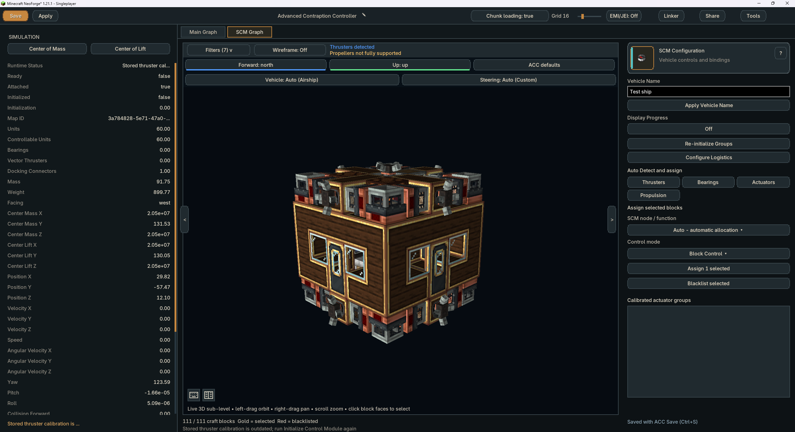
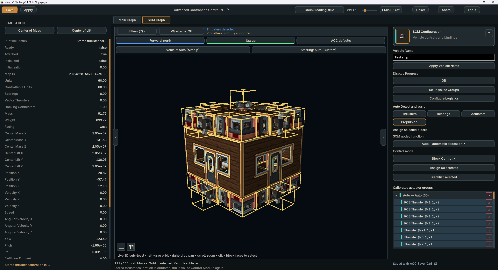

# Gadgets & Gizmos Ship Control Module Wiki

The Ship Control Module maps a Sable ship so an attached Advanced Contraption Controller can control it as one vehicle. Initialization finds the supported propulsion, bearings, docking connectors, and nested sub-levels, then makes Ship Control and Shipping Schedule nodes available on the attached controller.

The Ship Control Module is marked experimental. Airship control is supported; the Plane and Car control modes are present for compatibility but are not supported yet.

## Contents

- [Setting Up](#setting-up)
- [Initializing a Ship](#initializing-a-ship)
- [What Gets Mapped](#what-gets-mapped)
- [Ship Control Nodes](#ship-control-nodes)
- [Shipping Schedules and Docks](#shipping-schedules-and-docks)
- [Updating a Configuration](#updating-a-configuration)
- [Troubleshooting](#troubleshooting)

## Setting Up

1. Mount the Ship Control Module on a sturdy upward-facing block surface.
2. Place an Advanced Contraption Controller on the module's exposed face.
3. Build and assemble the Sable ship which the module should control.
4. Open the attached Advanced Contraption Controller. Ship Control nodes are available while it is mounted on the module.

The module supplies the map and ship-control runtime to the attached Advanced Contraption Controller. The ACC graph decides when and how the ship moves.

## Initializing a Ship

Open the `Advanced Control Computer` node graph and click on the `SCM` tab to open the `Ship Control Module` configuration GUI.

Create your control groups by selecting blocks in the 3D viewport and assigning them to groups in the right hand side bar.
You can assign blocks to multiple groups.
For blocks that require redstone from specific sides, use the right hand sidebar to change the selection mode from `Block Control` to `Redstone Control` in the `Control Mode` dropdown.

If your ship only uses `Thrusters` then you can simplify the setup by clicking `Propulsion` on the right hand side bar, then clicking `Assign to Auto` and `Re-Initialize control groups` before saving. This will tell the `Ship Control Module` to figure out the capabilities and positions of the thrusters automatically.

## What Gets Mapped

Initialization maps compatible propulsion units, bearings, vectoring equipment, nested sub-levels, Ship Couplers, docking connectors, and supported display sources on the assembled ship.

The stored map gives the controller a shared frame of reference for movement, navigation, docking, telemetry, and schedules. **Ship Telemetry** reports live movement, orientation, navigation, and collision data after the ship is initialized.

<strong>Useful Status Nodes</strong>

| Node | Use |
| --- | --- |
| Control Module Status | Check attachment, initialization state, mapped unit and bearing counts, inertia, map ID, and current status text. |
| Ship Telemetry | Read live ship motion, orientation, navigation, and collision data. |
| Ship Coupler Status | Read the state of mapped Ship Couplers and their connected carriages. |
| Shipping Travel Metrics | Read the route, fuel, and travel state of the active Shipping Schedule. |
| Shipping Manifest | Read the current and upcoming Ship Dock stops. |

## Ship Control Nodes

Ship movement nodes use an **Execution** pulse. Most return **Success**; rotation, navigation, docking, and carriage commands also pulse **Complete** when their command finishes.

Pulse **Max Speed** with a positive number to save the ship's maximum speed in **blocks per second**. Zero or a negative number removes the limit. The setting applies to all SCM movement, including direct controls and native walker pilots, and survives stopping controls, editing the graph, and saving or reloading the ship. Later pulses replace the saved value.

The **Speed** inputs on Navigate, Follow, Climb to Y Level, Face Coordinates, and Dock use percentages from 0 to 100. With Max Speed set to 40 blocks/s, a Speed of 50 requests up to 20 blocks/s. Braking, turning, collision avoidance, and available propulsion can reduce the actual speed. Without a saved limit, percentages retain their existing scaling against the ship's available safe speed.

Pulse **Follow** once to start tracking. It keeps reading its connected coordinates, speed, and distance inputs as they change, including after reaching the target. Pulse its **Stop Following** execution input to cancel that node's tracking; other independent ship controls remain active. A later main execution pulse starts tracking again.

<strong>Direct Movement</strong>

| Node | Use |
| --- | --- |
| Yaw, Pitch, Roll | Rotate the ship around the selected axis. |
| Pan, Tilt | Apply the matching bearing movement. |
| Accelerate, Forward, Reverse | Move the ship along its forward axis. |
| Strafe | Move the ship sideways. |
| Ascend, Descend | Move the ship vertically. |
| Stabilize, Decelerate, Hover | Apply the selected stabilization or stopping action. |
| Max Speed | Save a maximum speed in blocks/s; zero or negative removes the limit. |
| Stop Ship Control | Stops active Ship Control movement. |

<strong>Navigation</strong>

| Node | Use |
| --- | --- |
| Climb to Y Level | Move the ship to a world Y level at the selected speed. |
| Face Coordinates | Turn the ship to face world coordinates. |
| Navigate | Move the ship to world coordinates. |
| Follow | Continuously track changing coordinates after one pulse; Stop Following cancels tracking. |
| Dock at Coordinates | Move to a docking position with a tolerance and optional rotation target. |
| Set Flight Behavior | Choose how scheduled navigation turns and moves the ship. |

<strong>Carriages and Schedules</strong>

| Node | Use |
| --- | --- |
| Couple Carriage | Tells one Ship Coupler, or every Ship Coupler, to attach a carriage. |
| Decouple Carriage | Tells one Ship Coupler, or every Ship Coupler, to release a carriage. |
| Pause, Resume | Pauses or resumes the active Shipping Schedule. |
| Restart | Restarts the assigned Shipping Schedule from its first entry. |
| Skip | Skips the current Shipping Schedule entry. |
| Shipping Travel Metrics | Reports the route, fuel, and travel state of the active Shipping Schedule. |
| Shipping Manifest | Reports the current and upcoming Ship Dock stops. |

## Shipping Schedules and Docks

A Shipping Schedule needs a seated pilot, an Advanced Contraption Controller mounted on a Ship Control Module, and an initialized ship. Add at least one schedule stop before assigning the schedule to the pilot.

Use a [Ship Dock](Blocks-And-Interactions#ship-blocks) as a named destination. A dock can refuel ships, restock cargo, handle packages, and choose which doors on the docked ship should open. Docking connectors must be bound to the dock before their services can be used.

The **Park at** instruction selects a Ship Dock by name. **Refuel if** selects a matching refuelling dock and can use a wildcard name when the route should choose a suitable dock.

Schedule maximum-speed percentages use the saved **Max Speed** as their reference. For example, 25% with a 40 blocks/s limit allows up to 10 blocks/s. Changing Max Speed takes effect on an active route without restarting the schedule.

## Updating a Configuration

Run **Initialize Control Module** again after changing the ship's propulsion, bearings, docking connectors, couplers, or nested sub-level layout. The new initialization updates the stored map so the ACC does not continue to control removed or moved parts.

Use **Stop Initialization** to cancel an initialization that is no longer wanted.

## Troubleshooting

| Problem | Check |
| --- | --- |
| Ship nodes are missing | The ACC must be mounted on the exposed face of a Ship Control Module. |
| The ship does not respond | Run Initialize Control Module and wait for its Complete output before sending movement commands. |
| A component is not controlled | Check that it is assembled with the initialized ship, then initialize again after correcting the build. |
| A Shipping Schedule cannot be assigned | Seat a pilot directly in front of the ACC, mount the ACC on a Ship Control Module, initialize the ship, and add at least one stop. |
